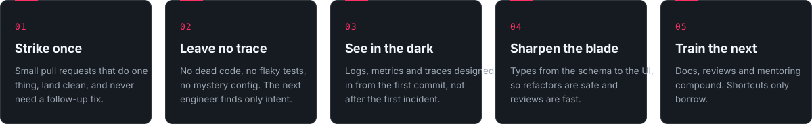

  
  &nbsp;
  
  &nbsp;
  

Full-stack engineer who builds web platforms that scale and stay up. I work the whole stack: **React** and **Next.js** in front, **Node.js**, **Go** and **Rust** behind the API, **PostgreSQL** and **Redis** underneath, and **Docker** and **Kubernetes** on **AWS** to run it all.

The style I aim for is quiet and precise. Small, well-tested changes that land cleanly, strong types from the database to the browser, and deployments that are boring because they were planned.

<table>
  <tr>
    <td width="50%" valign="top">
      <h4>Frontend</h4>
      Production interfaces with <b>React</b>, <b>Next.js</b> and <b>TypeScript</b>. Design systems, predictable state with <b>Redux</b>, and Core Web Vitals that stay green under real traffic.
    </td>
    <td width="50%" valign="top">
      <h4>Backend</h4>
      REST and <b>GraphQL</b> services in <b>Node.js</b>, <b>Go</b> and <b>Rust</b>. Clear boundaries, strong contracts, and observability built in from the first commit.
    </td>
  </tr>
  <tr>
    <td width="50%" valign="top">
      <h4>Data</h4>
      Schema design, query tuning and caching across <b>PostgreSQL</b>, <b>MySQL</b>, <b>MongoDB</b> and <b>Redis</b>, with <b>Prisma</b> keeping access type-safe end to end.
    </td>
    <td width="50%" valign="top">
      <h4>Cloud &amp; Delivery</h4>
      Containerized workloads on <b>AWS</b> with <b>Docker</b> and <b>Kubernetes</b>. CI/CD pipelines, infrastructure as code, and rollbacks that are one command away.
    </td>
  </tr>
</table>

<table align="center">
  <tr>
    <td align="right"><b>Languages</b></td>
    <td></td>
  </tr>
  <tr>
    <td align="right"><b>Frontend</b></td>
    <td></td>
  </tr>
  <tr>
    <td align="right"><b>Backend</b></td>
    <td></td>
  </tr>
  <tr>
    <td align="right"><b>Data</b></td>
    <td></td>
  </tr>
  <tr>
    <td align="right"><b>Cloud &amp; DevOps</b></td>
    <td></td>
  </tr>
  <tr>
    <td align="right"><b>Design &amp; Testing</b></td>
    <td></td>
  </tr>
</table>

<picture>
  <source media="(prefers-color-scheme: dark)" srcset="https://raw.githubusercontent.com/sk11001100/sk11001100/output/snake-dark.svg"/>
  <source media="(prefers-color-scheme: light)" srcset="https://raw.githubusercontent.com/sk11001100/sk11001100/output/snake.svg"/>
  
</picture>

Open to ambitious products, difficult problems and teams that care about craft.

  
  &nbsp;
  

