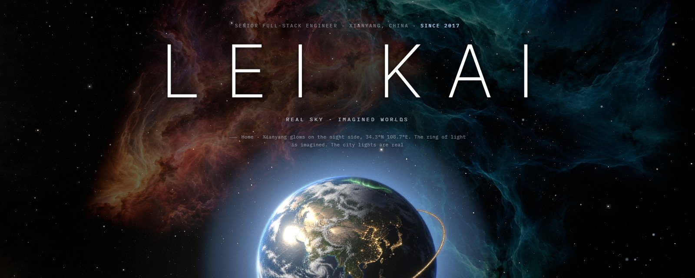
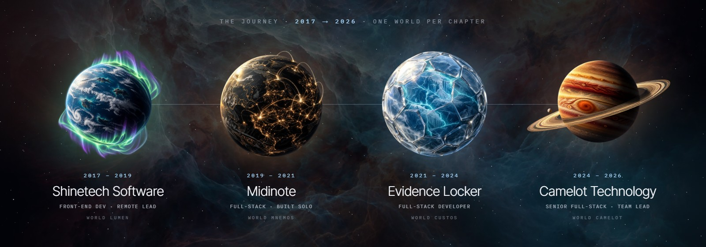
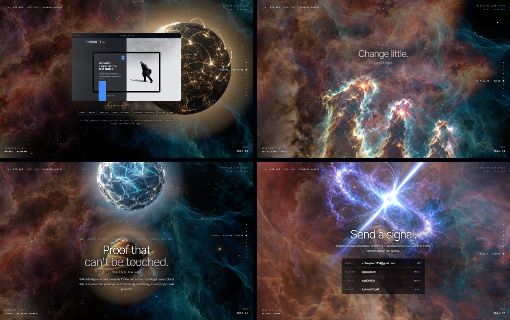

  
  &nbsp;
  
  &nbsp;
  
  &nbsp;
  

  <b>Senior full-stack engineer, developer and architect</b> in Xianyang, China. 
  Since 2017 I've led a remote front-end team, built a product entirely alone, shipped forensic-grade software for law enforcement, 
  and led the team behind a social-wager platform. TypeScript and Python by default; PHP, C#, cloud and LLMs when the work asks for them.

 

  <a href="https://shinetechsoftware.com">shinetechsoftware.com</a> &nbsp;·&nbsp;
  <a href="https://midinote.me">midinote.me</a> &nbsp;·&nbsp;
  <a href="https://evidencelocker.com">evidencelocker.com</a> &nbsp;·&nbsp;
  <a href="https://moneyinthepot.com">moneyinthepot.com</a> &nbsp;·&nbsp;
  <a href="https://camelot.fm">camelot.fm</a>

 

<h3 align="center">The flight</h3>

  My portfolio is one continuous flight through a real sky: 140,000 stars from NASA's Deep Star Maps, 
  with an imagined world for every chapter of my career and a live preview of each product. 
  Three.js · custom GLSL · no framework · <a href="https://sk11001100.github.io/sk11001100/">sk11001100.github.io/sk11001100</a>

 

<h3 align="center">Tools</h3>

<table align="center">
  <tr>
    <td align="right"><b>LANGUAGES</b></td>
    <td></td>
  </tr>
  <tr>
    <td align="right"><b>FRONTEND</b></td>
    <td></td>
  </tr>
  <tr>
    <td align="right"><b>BACKEND</b></td>
    <td></td>
  </tr>
  <tr>
    <td align="right"><b>DATA</b></td>
    <td></td>
  </tr>
  <tr>
    <td align="right"><b>CLOUD &amp; DEVOPS</b></td>
    <td></td>
  </tr>
  <tr>
    <td align="right"><b>DELIVERY &amp; QUALITY</b></td>
    <td></td>
  </tr>
</table>

Also: LLMs · RAG pipelines · AI inference services · SQL Server · Oracle · CouchDB / PouchDB · React Native · Oracle APEX

 

<h3 align="center">How I work</h3>

  <b>Change little.</b> Land it right. 
  <b>Leave nothing behind.</b> No dead code, no mystery config. 
  <b>See in the dark.</b> Logs, metrics and alerts before launch day. 
  <b>Earn every tool.</b> Learn it deeply. Use it where it pays. 
  <b>Teach what I know.</b> Reviews that teach, standards that outlive me.

 

<picture>
  <source media="(prefers-color-scheme: dark)" srcset="https://raw.githubusercontent.com/sk11001100/sk11001100/output/snake-dark.svg"/>
  <source media="(prefers-color-scheme: light)" srcset="https://raw.githubusercontent.com/sk11001100/sk11001100/output/snake.svg"/>
  
</picture>

  Hiring for a senior or lead role, or holding a problem nobody else wants to touch? 
  <a href="mailto:coblerpeach354@gmail.com">coblerpeach354@gmail.com</a> &nbsp;·&nbsp; <a href="https://t.me/kailei0325">Telegram @kailei0325</a>

