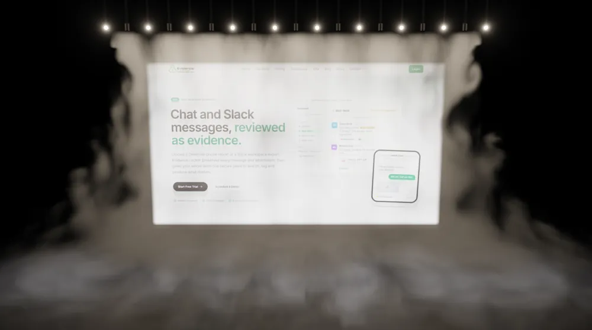

  I'm a senior full-stack engineer and architect in Xianyang, China. 
  Since 2017 I've led a remote front-end team, built a product entirely alone, 
  shipped forensic software for law enforcement, and led the team behind a social-wager platform.

  <a href="https://sk11001100.github.io/sk11001100/"><b>Portfolio</b></a> &nbsp;·&nbsp;
  <a href="mailto:coblerpeach354@gmail.com">Email</a> &nbsp;·&nbsp;
  <a href="https://t.me/kailei0325">Telegram</a> &nbsp;·&nbsp;
  <a href="./docs/assets/Lei-Kai-CV.pdf">Résumé</a>

 

  2017 – 2019 &nbsp;<a href="https://shinetechsoftware.com"><b>Shinetech Software</b></a> &nbsp;·&nbsp; front-end developer, remote team lead 
  2019 – 2021 &nbsp;<a href="https://midinote.me"><b>Midinote</b></a> &nbsp;·&nbsp; full-stack, built the whole product alone 
  2021 – 2024 &nbsp;<a href="https://www.evidencelocker.com"><b>Evidence Locker</b></a> &nbsp;·&nbsp; full-stack, forensic cloud evidence 
  2024 – 2026 &nbsp;<b>Camelot Technology</b> &nbsp;·&nbsp; senior full-stack, team lead

 

  LANGUAGES 
  TypeScript · JavaScript · Python · PHP · C# · Java
    
  FRONT END 
  React · Next.js · Redux · React Native · Angular · Vue · Nuxt · Three.js · WebGL
    
  BACK END 
  Node.js · Express · Django · FastAPI · Flask · Laravel · ASP.NET
    
  DATA &amp; AI 
  PostgreSQL · MySQL · SQL Server · MongoDB · Redis · CouchDB · LLMs · RAG
    
  CLOUD &amp; DELIVERY 
  AWS · Docker · Kubernetes · Kafka · Azure · GCP · GitHub Actions · Jenkins · Jest · Cypress

 

  <i>Change little.</i> Land it right. 
  <i>Leave nothing behind.</i> No dead code, no mystery config. 
  <i>See in the dark.</i> Logs, metrics and alerts before launch day. 
  <i>Earn every tool.</i> Learn it deeply. Use it where it pays. 
  <i>Teach what I know.</i> Reviews that teach, standards that outlive me.

 

  Open to senior and lead roles &nbsp;·&nbsp; <a href="mailto:coblerpeach354@gmail.com">coblerpeach354@gmail.com</a> 
  The mist above is real: a fluid simulation lit by ten lamps, rendered in WebGL. <a href="https://sk11001100.github.io/sk11001100/">Move your hand through it.</a>

