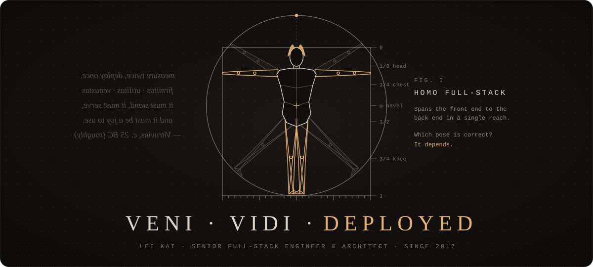
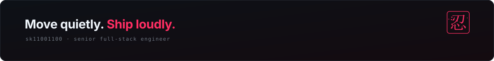

  I'm Lei Kai, a senior full-stack engineer and architect in Xianyang, China. 
  Vitruvius, Caesar's engineer, wrote that a building must <i>stand</i>, <i>serve</i> and <i>delight</i>. 
  I hold software to the same three rules. This page is laid out the same way.

  <a href="https://sk11001100.github.io/sk11001100/"><b>Portfolio</b></a> &nbsp;·&nbsp;
  <a href="./docs/assets/Lei-Kai-CV.pdf">Résumé</a> &nbsp;·&nbsp;
  <a href="mailto:coblerpeach354@gmail.com">Email</a> &nbsp;·&nbsp;
  <a href="https://t.me/kailei0325">Telegram</a>

 

<b>I &nbsp;·&nbsp; FIRMITAS</b> &nbsp;·&nbsp; <i>it must stand</i>

   
  

Data, cloud and delivery. Also SQL Server and CouchDB.

 

<b>II &nbsp;·&nbsp; UTILITAS</b> &nbsp;·&nbsp; <i>it must serve</i>

   
  

Languages and back ends. Also LLMs and RAG, wired into real products.

 

<b>III &nbsp;·&nbsp; VENUSTAS</b> &nbsp;·&nbsp; <i>it must delight</i>

  

Front ends. Also React Native, and raw WebGL when a page deserves it.

 

<b>IV &nbsp;·&nbsp; OPERA</b> &nbsp;·&nbsp; <i>the work</i>

  2017 – 2019 &nbsp;<a href="https://shinetechsoftware.com"><b>Shinetech Software</b></a> &nbsp;·&nbsp; front-end developer, remote team lead 
  2019 – 2021 &nbsp;<a href="https://midinote.me"><b>Midinote</b></a> &nbsp;·&nbsp; full-stack, built the whole product alone 
  2021 – 2024 &nbsp;<a href="https://www.evidencelocker.com"><b>Evidence Locker</b></a> &nbsp;·&nbsp; full-stack, forensic cloud evidence 
  2024 – 2026 &nbsp;<b>Camelot Technology</b> &nbsp;·&nbsp; senior full-stack, team lead

 

<b>V &nbsp;·&nbsp; PRINCIPIA</b> &nbsp;·&nbsp; <i>how I work</i>

  <i>Change little.</i> Land it right. 
  <i>Leave nothing behind.</i> No dead code, no mystery config. 
  <i>See in the dark.</i> Logs, metrics and alerts before launch day. 
  <i>Earn every tool.</i> Learn it deeply. Use it where it pays. 
  <i>Teach what I know.</i> Reviews that teach, standards that outlive me.

 

<b>VI &nbsp;·&nbsp; DIARIUM</b> &nbsp;·&nbsp; <i>the daily climb</i>

  <picture>
    <source media="(prefers-color-scheme: dark)" srcset="https://raw.githubusercontent.com/sk11001100/sk11001100/output/snake-dark.svg"/>
    <source media="(prefers-color-scheme: light)" srcset="https://raw.githubusercontent.com/sk11001100/sk11001100/output/snake-light.svg"/>
    
  </picture> 
  A year of commits. The snake eats them all. Tomorrow I write more.

 

  Open to senior and lead roles &nbsp;·&nbsp; <a href="mailto:coblerpeach354@gmail.com">coblerpeach354@gmail.com</a> &nbsp;·&nbsp; <a href="https://sk11001100.github.io/sk11001100/">sk11001100.github.io/sk11001100</a>

