<p align="center">
  <a href="mailto:coblerpeach354@gmail.com"></a>
  &nbsp;
  <a href="https://t.me/kailei0325"></a>
  &nbsp;
  <a href="https://github.com/sk11001100"></a>
</p>


## About

Full-stack engineer focused on building web platforms that scale and stay up. I work across the whole stack — React and Next.js on the front, Node.js, Go and Rust behind the API, PostgreSQL and Redis underneath, and Docker and Kubernetes on AWS to run it all.

I care about strong typing from the database to the browser, clear service boundaries, and deployments that are boring because they were planned. The style I aim for is quiet and precise: small, well-tested changes that land cleanly and keep working long after the pull request is closed.

```ts
const engineer = {
  handle:   "sk11001100",
  role:     "Senior Full-Stack Engineer",
  focus:    ["Scalable web platforms", "Type-safe APIs", "Cloud-native infrastructure"],
  stack:    ["TypeScript", "Go", "Rust", "React", "Next.js", "Node.js", "PostgreSQL", "AWS", "Kubernetes"],
  approach: "Precision over noise. Reliability over speed. Both when it counts.",
} as const;
```

## What I do

<table>
  <tr>
    <td width="50%" valign="top">
      <h4>Frontend</h4>
      Production interfaces with <b>React</b>, <b>Next.js</b> and <b>TypeScript</b>. Design systems, predictable state with <b>Redux</b>, and Core Web Vitals that stay green under real traffic.
    </td>
    <td width="50%" valign="top">
      <h4>Backend</h4>
      REST and <b>GraphQL</b> services in <b>Node.js</b>, <b>Go</b> and <b>Rust</b>. Clear boundaries, strong contracts, and observability built in from the first commit.
    </td>
  </tr>
  <tr>
    <td width="50%" valign="top">
      <h4>Data</h4>
      Schema design, query tuning and caching across <b>PostgreSQL</b>, <b>MySQL</b>, <b>MongoDB</b> and <b>Redis</b>, with <b>Prisma</b> keeping access type-safe end to end.
    </td>
    <td width="50%" valign="top">
      <h4>Cloud &amp; Delivery</h4>
      Containerized workloads on <b>AWS</b> with <b>Docker</b> and <b>Kubernetes</b>. CI/CD pipelines, infrastructure as code, and rollbacks that are one command away.
    </td>
  </tr>
</table>

## Tech stack

<table align="center">
  <tr>
    <td align="right"><b>Languages</b></td>
    <td></td>
  </tr>
  <tr>
    <td align="right"><b>Frontend</b></td>
    <td></td>
  </tr>
  <tr>
    <td align="right"><b>Backend</b></td>
    <td></td>
  </tr>
  <tr>
    <td align="right"><b>Data</b></td>
    <td></td>
  </tr>
  <tr>
    <td align="right"><b>Cloud &amp; DevOps</b></td>
    <td></td>
  </tr>
  <tr>
    <td align="right"><b>Design &amp; Testing</b></td>
    <td></td>
  </tr>
</table>

## How I work

| | Principle | In practice |
|:-:|:--|:--|
| 01 | **Precision over noise** | Small pull requests that do one thing, with a description a reviewer can trust. |
| 02 | **Reliability is a feature** | Timeouts, retries, idempotency and metrics are part of the design, not a follow-up ticket. |
| 03 | **Types all the way down** | Shared contracts from the schema to the UI, so refactors are safe and reviews are fast. |
| 04 | **Boring deployments** | Automated pipelines, feature flags and tested rollbacks. Production should never be exciting. |
| 05 | **Leave the codebase stronger** | Docs, reviews and mentoring compound; shortcuts only borrow. |


## GitHub activity

<div align="center">


<br/><br/>


<br/><br/>

<picture>
  <source media="(prefers-color-scheme: dark)" srcset="https://raw.githubusercontent.com/sk11001100/sk11001100/output/snake-dark.svg"/>
  <source media="(prefers-color-scheme: light)" srcset="https://raw.githubusercontent.com/sk11001100/sk11001100/output/snake.svg"/>
  
</picture>

</div>

## Contact

Open to ambitious products, difficult problems and teams that care about craft.

<p>
  <a href="mailto:coblerpeach354@gmail.com"></a>
  &nbsp;
  <a href="https://t.me/kailei0325"></a>
</p>


